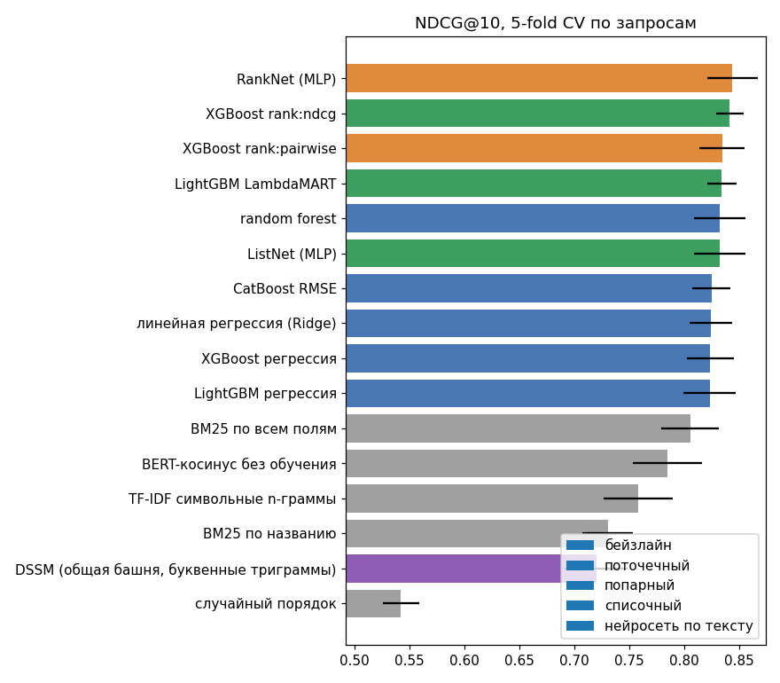

# Learning to rank: поиск по каталогу мебели

Ранжирование товаров по поисковому запросу на датасете WANDS (Wayfair): 480 запросов, 43 тыс. товаров, 233 тыс. пар
с асессорскими оценками Exact / Partial / Irrelevant. 27 признаков (BM25 по полям с нуля, TF-IDF, символьные n-граммы,
LSA, BERT), три подхода к LTR — поточечный, попарный, списочный — и нейросетевая модель DSSM.

> Теория (NDCG, BM25, RankNet, LambdaMART, би- и кросс-энкодеры) и разбор результатов — в [GUIDE.md](GUIDE.md).

## Результаты

5-fold кросс-валидация **по запросам**: запросы test-фолда модель не видела.

| подход | модель | NDCG@10 | MRR |
|---|---|---|---|
| бейзлайн | случайный порядок | 0.542 ± 0.017 | 0.315 |
| бейзлайн | BM25 по названию | 0.730 ± 0.023 | 0.676 |
| бейзлайн | **BM25 по всем полям** | **0.805 ± 0.026** | 0.762 |
| бейзлайн | BERT-косинус без обучения (all-MiniLM-L6-v2) | 0.785 ± 0.031 | 0.684 |
| поточечный | линейная регрессия (Ridge) | 0.824 ± 0.019 | 0.752 |
| поточечный | random forest | 0.832 ± 0.023 | 0.759 |
| поточечный | XGBoost / LightGBM / CatBoost, регрессия | 0.823–0.825 | 0.734–0.763 |
| попарный | **RankNet (MLP, PyTorch)** | **0.844 ± 0.023** | **0.797** |
| попарный | XGBoost rank:pairwise | 0.834 ± 0.021 | 0.751 |
| списочный | ListNet (MLP, PyTorch) | 0.832 ± 0.023 | 0.773 |
| списочный | LightGBM LambdaMART | 0.834 ± 0.013 | 0.765 |
| списочный | XGBoost rank:ndcg | 0.841 ± 0.013 | 0.776 |
| текстовая нейросеть | DSSM (буквенные триграммы, общая башня) | 0.720 ± 0.029 | 0.611 |

- **BM25 по всем полям — сильный бейзлайн**: обученные модели прибавляют +0,02–0,04.
- **Попарные и списочные лоссы лучше поточечных**. Лучший RankNet: +0,039 к BM25 (критерий Уилкоксона по 480
  запросам, p = 2·10⁻⁷) и +0,012 к лучшей поточечной модели (p = 0,008).
- **Абляция LambdaMART**: без признаков класса запроса −0,027, без BERT и LSA −0,013, только лексические признаки −0,041.
  BERT как признак даёт +0,007 — статистически незначимо (p = 0,15).
- **DSSM на 384 обучающих запросах не работает**: с раздельными башнями — уровень случайного порядка (запросная башня
  запоминает обучающие запросы), с общей башней — ниже TF-IDF по символьным n-граммам. Нейросетевым текстовым моделям
  нужны логи с миллионами запросов; разбор — в GUIDE.
- CatBoost с PairLogit / YetiRank в сравнение не вошли: на CPU при группах до 4 329 товаров одно обучение на 45 запросах
  шло 2,5–3 минуты, полная кросс-валидация заняла бы часы.



Полный отчёт с NDCG@5, P@10 и важностью признаков: [reports/results.md](reports/results.md).

## Запуск

```bash
pip install -r requirements.txt
python scripts/build_features.py      # WANDS (~95 МБ) + признаки + BERT-эмбеддинги, ~7 мин на CPU
python scripts/run_experiments.py     # 5-fold CV всех моделей, ~35 мин
pytest                                # 10 тестов: BM25 против формулы, NDCG, лоссы, признаки, DSSM
```

## Структура

| путь | что там |
|---|---|
| `src/ltr/text.py` | токенизация, BM25 с нуля, косинусы по строкам разреженных матриц |
| `src/ltr/features.py` | 27 признаков в 5 группах: lexical, overlap, qclass, meta, semantic |
| `src/ltr/metrics.py` | NDCG@k, MRR, P@k по запросам, случайное разбиение ничьих |
| `src/ltr/neural.py` | RankNet, ListNet и DSSM на PyTorch |
| `scripts/` | сборка признаков, эксперименты |
| `reports/` | отчёт и графики |
